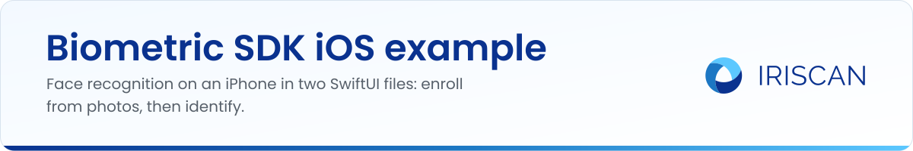

# Biometric SDK iOS example

A small SwiftUI app that shows the [Iriscan Biometric SDK](https://github.com/biometric-technologies/biometric-sdk) doing face recognition on an iPhone, with no server involved. It enrolls two people from bundled photos, then lets you pick a random test photo and asks the SDK who is in it. Use it to see the SDK API in a working Xcode project before you add it to your own app.

## What it does

- Initializes the SDK at launch with a FaceNet model bundled as `facenet-default.tflite` (160 x 160 input, 128-value embedding, match threshold 10.0). See `biometric_sdk_ios_exampleApp.swift`.
- Builds a tiny in-memory "database" when the view appears: every image in the `sheldon` and `howard` bundle folders is turned into a face template.
- "Load Random" shows one of four bundled test photos (`img1` to `img4`).
- "Detect" extracts a template from the shown photo, compares it with every enrolled template using `matchesAny` and shows the matching name, or "Unknown".

The whole demo is two Swift files in the `biometric-sdk-ios-example/` folder.

## How to run

You need Xcode, CocoaPods and an iOS 15.0 or newer device or simulator.

```sh
git clone https://github.com/biometric-technologies/biometric-sdk-ios-example
cd biometric-sdk-ios-example
pod install
open biometric-sdk-ios-example.xcworkspace
```

Open the `.xcworkspace`, not the `.xcodeproj`, otherwise the pods are not found. Select a simulator or device and press Run. Wait for the "Db initialized" alert, then tap "Load Random" and "Detect".

The Podfile pins `BiometricSdk` 0.2, which pulls in TensorFlow Lite 2.11.0; `Podfile.lock` was produced with CocoaPods 1.11.2. Newer SDK releases (0.6.0 at the time of writing) change the initialization call; see [docs.iriscan.com/sdk](https://docs.iriscan.com/sdk) for the current API.

## Related repositories

- [biometric-sdk](https://github.com/biometric-technologies/biometric-sdk): the SDK itself (Android, iOS, JVM).
- [biometric-sdk-cocoapods-release](https://github.com/biometric-technologies/biometric-sdk-cocoapods-release): the `BiometricSdk` pod and XCFramework.
- [biometric-sdk-android-example](https://github.com/biometric-technologies/biometric-sdk-android-example): the same demo in Kotlin.
- [biometric-sdk-react-native](https://github.com/biometric-technologies/biometric-sdk-react-native): React Native wrapper with face comparison and liveness.
- [docs](https://github.com/biometric-technologies/docs): source of the developer documentation at docs.iriscan.com.

## License

License: not yet specified. The Biometric SDK this example depends on is licensed under GPL-3.0; a commercial license for closed-source products is available: https://www.iriscan.com/commercial-license.

## Contact

info@iriscan.com, https://www.iriscan.com
